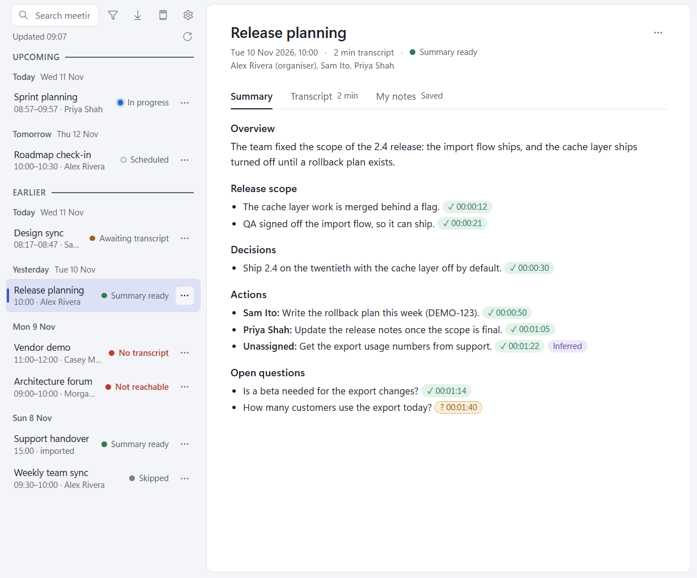

# Meeting capture

A Windows tray app for your Teams meetings. It lists your meetings, fetches each transcript when the call ends,
has Claude write a summary whose every point cites the transcript with a checked quote, and keeps every meeting
as plain files in a library folder you choose. It also nudges you when a call is running without transcription.

Everything runs through your own Claude Code and claude.ai account: the app has no server and no API key of its own.



## Requirements

- Windows 11 (it has the WebView2 runtime the app needs).
- [Claude Code](https://docs.anthropic.com/en/docs/claude-code) installed, on PATH, and signed in to your claude.ai
  account.
- The **Microsoft 365** connector connected in claude.ai, so Claude can read your calendar and Teams transcripts. The
  **Atlassian** connector is optional: with it, the Jira keys a summary mentions are checked; without it they are
  marked as not found.

## Install

Download the latest `.msi` from the [Releases](https://github.com/Lawls91/meeting-capture/releases) page and
double-click it. It installs for you only, so there is no admin prompt (Windows SmartScreen may ask once). To build the
installer yourself, see [Development](docs/development.md#build-and-run).

## Quick start

Start Meeting capture from the Start menu. The first run checks that Claude Code is found, offers a library folder
(`Documents\Meeting capture`) and asks whether to start when you log in; press **Finish**. The list then fills with your
Teams meetings through the end of the next working day. Leave the app running in the tray: when a meeting ends it fetches the
transcript and writes the summary on its own, and a notification says when the summary is ready. Older meetings can
be brought in with **Import > From Teams**.

## Documentation

- [Getting started](docs/getting-started.md): install, first run, the tray
- [The meeting list](docs/meeting-list.md): what each state means and what happens next
- [Summaries and transcripts](docs/summaries-and-transcripts.md): citations, corrections and the glossary
- [My notes](docs/my-notes.md)
- [Search](docs/search.md)
- [Meeting actions](docs/meeting-actions.md): Skip, Delete, Exclude series, Copy, Replace transcript, Re-run summary
- [Importing](docs/importing.md): a transcript file, or past meetings from Teams
- [Settings](docs/settings.md)
- [Updates](docs/updates.md)
- [The Claude skill](docs/claude-skill.md): ask your own Claude sessions about your meetings
- [Troubleshooting and known limitations](docs/troubleshooting.md)
- [Development](docs/development.md): build, test, CI, release and the file formats

## For developers

```
npm install
npx tauri dev     # run it
npm run check     # every suite plus the 80% coverage gate: the local verdict before a push
```

The rest (dev instances, the E2E suite, CI, cutting a release) is in [Development](docs/development.md).
