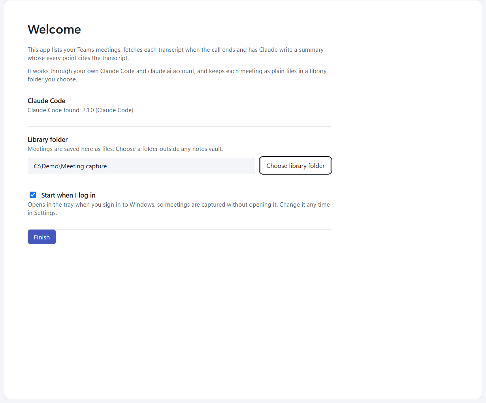

# Getting started

## What you need

- Windows 11.
- Claude Code installed and on PATH (the app runs the first `claude.exe` or `claude.cmd` it finds), signed in to
  your claude.ai account.
- The Microsoft 365 connector connected in claude.ai. The app asks Claude to read your Outlook calendar and your Teams
  transcripts through it, and reads only what the connector answers.
- Optional: the Atlassian connector, so the Jira keys a summary mentions are checked against Jira.

Meeting data stays in your library folder and goes only to Claude, through your own account.

## Install

Run the `.msi`. It installs for your Windows user only, so there is no admin (UAC) prompt; it is not code-signed, so
SmartScreen may ask once. It adds a Start menu shortcut, and by default starts the app when you log in.

Uninstall from **Settings > Apps > Installed apps**. That removes the app, its shortcut and its start-at-logon entry.
Your settings and your library folder are kept.

## First run

Until a library folder is chosen, the window opens on a Welcome page instead of the meeting list.

- **Claude Code** says which version was found, or, in red, "Claude Code not found. Install it or add it to PATH, then
  restart the app." You can still press Finish, but fetches and summaries fail until Claude Code is installed.
- **Library folder** offers `Documents\Meeting capture` (wherever your Documents folder is, OneDrive included). Press
  **Choose library folder** to pick another. The folder is made when you press Finish, not before. Pick a folder
  the app can keep to itself: it owns the files in it.
- **Start when I log in** is ticked. Untick it if you'd rather start the app yourself.

Press **Finish** to save these and open the meeting list. You can change all three later in [Settings](settings.md).

Nothing is fetched or summarised before you press Finish.

## The tray

Meeting capture lives in the Windows tray. Closing the window only hides it there, so meetings are still captured.
The tray menu has:

- **Open Meeting capture**
- **Settings**
- **Refresh calendar now**
- **Start at logon** (a tick)
- **Check for updates** (it reads **Restart and update to version X** once an update is ready, see
  [Updates](updates.md))
- **Quit**: saves your notes and stops the app. Nothing is captured while it is not running; bring missed meetings
  in later with [Import from Teams](importing.md#import-from-teams).

Starting the app again while it runs just brings its window to the front.

## Next

- [The meeting list](meeting-list.md) explains what you see and what the app does on its own.
- [Summaries and transcripts](summaries-and-transcripts.md) explains how to read a summary.
