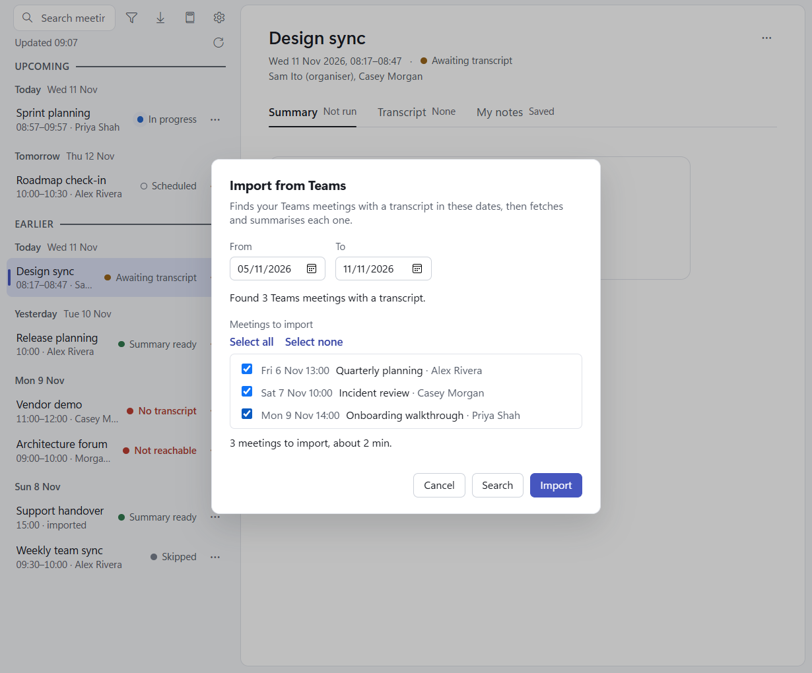

# Importing

The list's **Import** button (the down arrow at the top) opens a menu with **Transcript file…** and **From Teams…**.

Only Teams transcripts in `.vtt` form can be imported. In Teams, open the meeting's recap, go to its transcript and
download it as `.vtt`. A file that isn't a `.vtt`, isn't UTF-8 text or has no transcript lines is refused with the
reason, and nothing is made.

## A transcript file as a new meeting

**Import > Transcript file…** picks a `.vtt` and adds it as a new meeting: the meeting is named after the file, and
dated by the file's modified time. Its summary starts at once; the status line under the search box says
"Summarising Release planning…", then "Release planning: Summary ready.".

## Attach a transcript to a meeting

For a meeting the app couldn't fetch (No transcript, Not reachable, Capture failed) or is still waiting for
(Awaiting transcript):

- press **Import transcript** on its card and pick the `.vtt` (the three failure states also have it on their
  **...** menu), or
- for the three failure states, drop the `.vtt` on the **Attach the transcript** strip under the card.

The transcript joins that meeting and its summary starts. To swap a transcript a meeting already has, use
[Replace transcript…](meeting-actions.md#replace-transcript).

## Import from Teams

For meetings the app wasn't running for: **Import > From Teams…** finds past Teams meetings that have a transcript,
then fetches and summarises the ones you pick.

1. Pick **From** and **To** (the last 7 days by default). To can't be later than today, and the range is at most 31
   days.
2. Press **Search**. The app asks Claude to search your calendar, one day at a time, and says how many Teams meetings
   with a transcript it found that have ended. It leaves out, and counts, meetings already in your library (captured
   or skipped), meetings you deleted, and meetings in an excluded series. If some calendar entries couldn't be read it
   says "2 couldn't be read. Search again to retry." Nothing is fetched yet.
3. Review the list: every meeting found, oldest first, with its date, time, title and organiser, all ticked. Untick
   the ones you don't want (**Select all** and **Select none** help). The line under the list gives a rough time:
   "3 meetings to import, about 2 min."
4. Press **Import**. The ticked meetings are fetched and summarised exactly as after a live meeting, several at once.
   The status line shows "Importing: 3 of 7 done…", and each meeting appears in the list as it lands.

When the import ends, a banner keeps its report until you dismiss it, for example "Imported 3: 2 summarised, 0 not
reachable, 1 no transcript, 0 failed." A meeting whose transcript turned out to be empty stays as a No transcript row,
so you can attach the transcript yourself or delete it; it is in your library now, so a later Search of the same
dates leaves it out.

Changed the dates? Press Search again: Import fetches only what the latest Search found.

**Cost.** Each Claude run uses your claude.ai plan: one short run per day searched, then two per meeting (one to fetch,
one to summarise). Importing 7 meetings found over 7 days is 21 runs. A run takes about 13 seconds just to start, so
the app runs several side by side: a 10-meeting import takes a few minutes.
