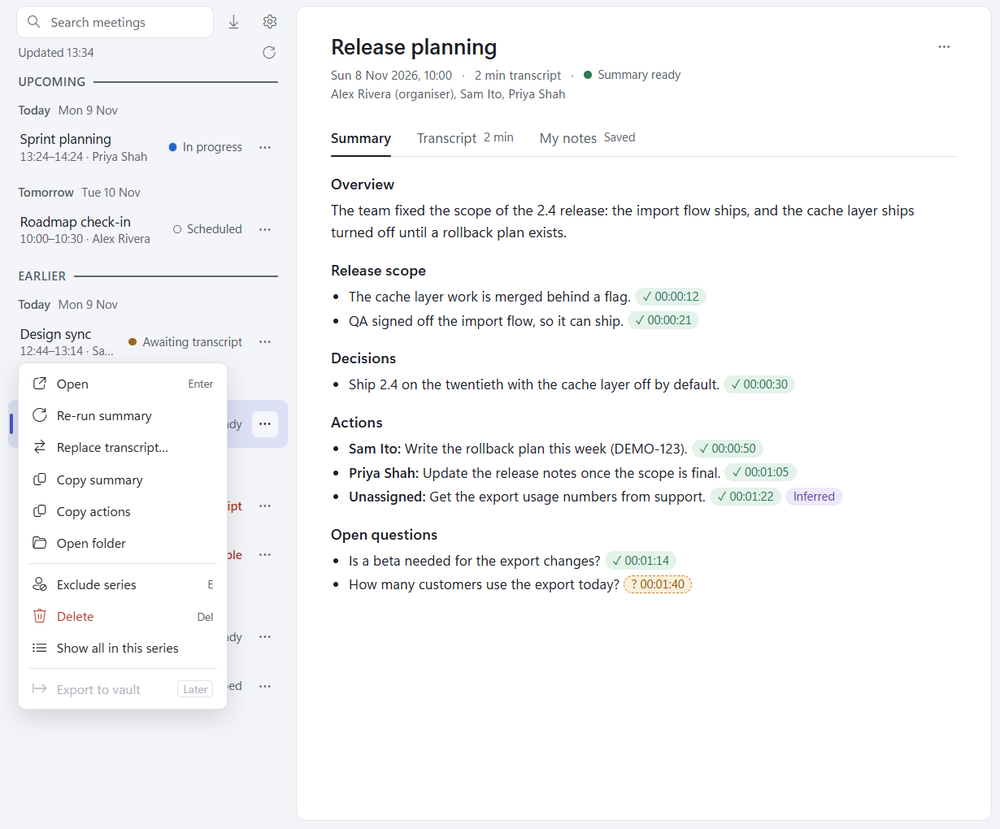

# Meeting actions

Each row's **...** button (or a right-click on the row) opens its menu. An open meeting has the same menu on the
**...** at the top right of its pane. Only the actions that make sense for the meeting are shown.

| Action | Key | Shown when |
| --- | --- | --- |
| Open | Enter | Always. |
| Import transcript | | No transcript, Not reachable or Capture failed (shown first, in bold). |
| Re-run summary | | There is a summary and no summary is running. On Summary failed it is shown first, in bold (Run summary if there was never a summary). |
| Replace transcript… | | There is a transcript and no summary is running. |
| Copy summary, Copy actions | | There is a summary. |
| Open folder | | The meeting has a folder in the library. |
| Skip | S | The meeting can still be fetched: Scheduled, In progress or Awaiting transcript. |
| Exclude series (or Include series) | E | It is a Teams meeting. |
| Delete | Del | The meeting has a folder, and no summary is running. |
| Show all in this series | | It is a Teams meeting. |
| Export to vault | | Not available yet (marked "Later"). |

## Skip, Delete or Exclude series?

| | Skip | Delete | Exclude series |
| --- | --- | --- | --- |
| Affects | This meeting | This meeting | Every meeting in the series |
| Folder | Kept (made at once if there wasn't one) | Moved to the Recycle Bin | Kept |
| Fetching and summaries | Stopped | Stopped for good | Stopped for every occurrence not yet captured |
| Stays in the list | Yes, as Skipped | No | Yes, as Skipped |
| Undo | **Unskip** | None | **Include series**, or Remove in Settings |

### Skip

Skip tells the app not to capture this meeting: it is never fetched or summarised, and the meeting chat is not
checked. Use it for a meeting you don't want recorded in your library, before or during the call. The
"Transcription isn't on" notification has a **Skip this meeting** button that does the same.

Skip is offered only while a fetch can still happen: on Scheduled, In progress and Awaiting transcript meetings. Once
fetching is over (No transcript, Not reachable, Capture failed) there is nothing left to skip, so Skip isn't offered;
use Delete to get rid of such a meeting. A meeting that already has a transcript has no Skip either.

The skip is kept in the meeting's folder, so it survives a restart. **Unskip**, on the Skipped meeting's card, undoes
it:

- an upcoming meeting is fetched when it ends, as usual;
- one that ended less than 2 hours ago is fetched at once;
- one that ended earlier becomes No transcript (import its transcript by hand if you have it).

### Delete

Delete asks first, for example `Delete “Release planning” (Sun 8 Nov 10:00)?`, then moves the meeting's folder, with its
transcript, summary and notes, to the Windows Recycle Bin.

A deleted meeting never comes back: not at the next calendar refresh, not after a restart, and not through
[Import from Teams](importing.md#import-from-teams), which counts it as deleted and leaves it out. Delete isn't
offered while the meeting's summary is being written, or for a calendar meeting the app hasn't made a folder for yet
(Skip that one instead).

### Exclude series

Exclude series stops the app capturing every occurrence of a recurring meeting (the occurrences share one Teams
link). Occurrences without a transcript list as Skipped, and their card offers **Include series**. Occurrences
already captured keep their transcript and summary. An exclusion made while a fetch is running still holds: that
capture is dropped and no summary starts.

Excluded series are listed in [Settings](settings.md), each with **Remove**.

## Show all in this series

Filters the list to the meetings that share this meeting's Teams link, upcoming first, then earlier ones, under a
chip "Series: <subject> ×". Press × to show all meetings again. [Search](search.md) works inside the filter.

## Copy summary and Copy actions

**Copy summary** copies the meeting's summary to the clipboard as Markdown. **Copy actions** copies just the action
items, one line each: `- Sam Ito: Write the rollback plan this week.` (or `- Unassigned: ...`). A short notice
confirms the copy.

## Replace transcript…

Picks a `.vtt` file to use as the meeting's transcript instead of the one it has, then writes the summary again. It is
refused while a summary is running, and on a skipped meeting (Unskip it first).

## Run summary and Re-run summary

**Run summary**, on the card of a meeting with a transcript and no summary, writes its first summary (the summary
usually starts on its own). **Re-run summary** writes it again; see
[Summaries and transcripts](summaries-and-transcripts.md#re-run-summary).

## Keyboard

- The list is one Tab stop. The arrow keys move through the rows (and search hits); Enter opens one.
- **S** skips, **E** excludes the series and **Del** deletes the row under the keyboard cursor, when the menu offers
  that action. Keys typed in My notes never do this.
- **Esc** closes the open menu, the citation sheet or Settings, and focus goes back to what opened it.
