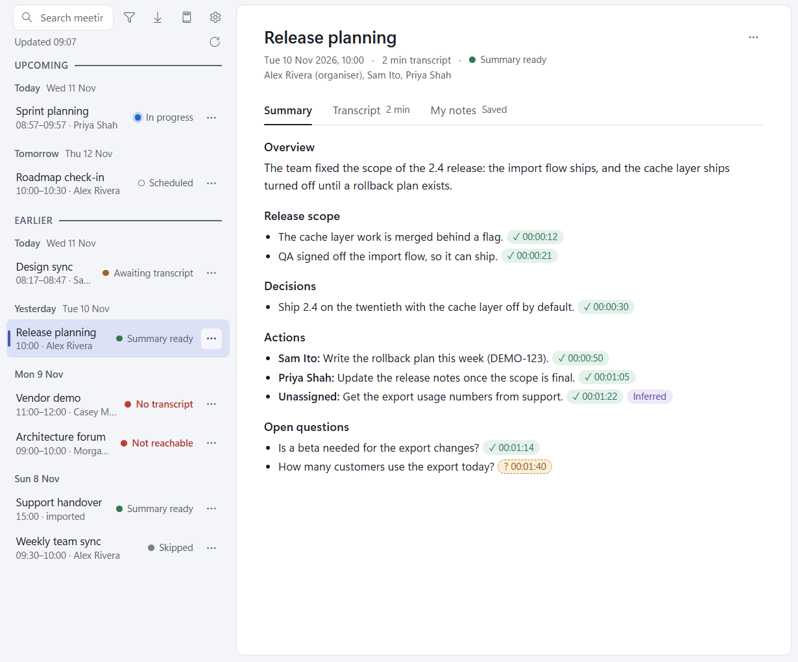
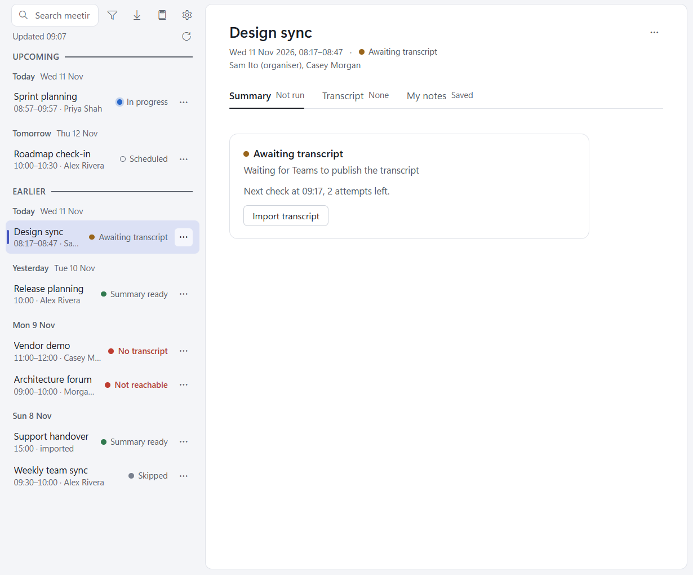
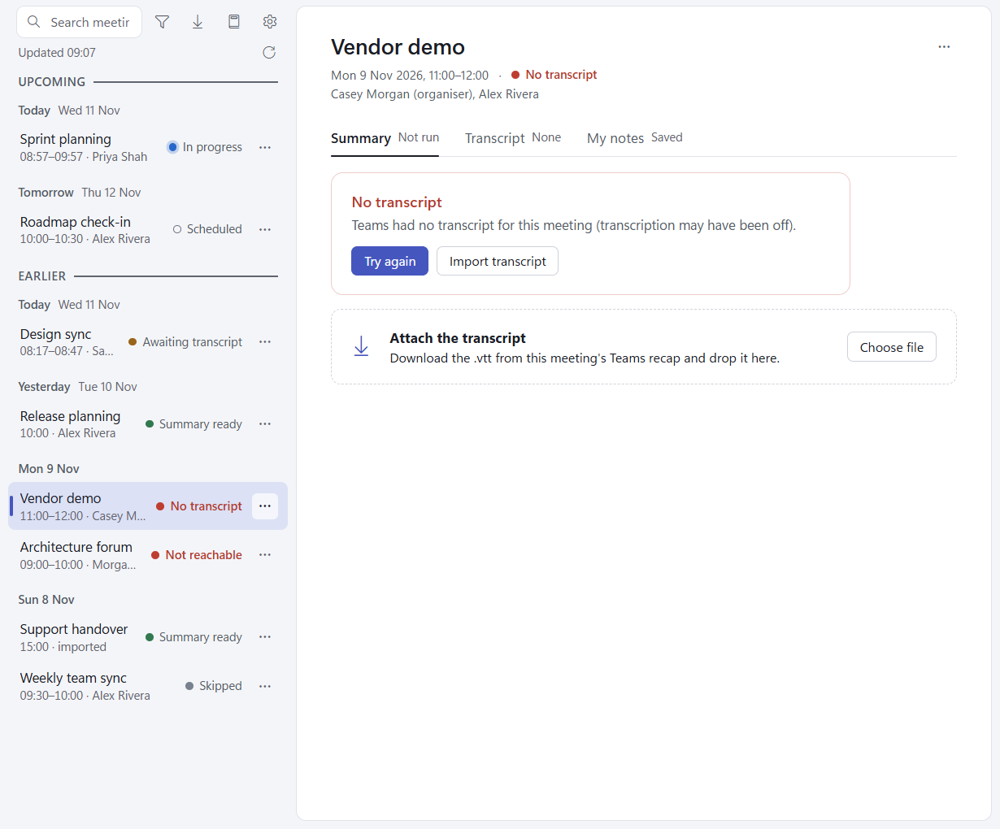

# The meeting list

The left pane lists your meetings; click one to open it on the right.

- **Upcoming**: meetings that haven't ended yet, in time order, the one in progress first (also when its call runs
  over the scheduled end). Grouped by day (Today, Tomorrow, then the date).
- **Earlier**: meetings that have ended, newest first, grouped by day. With nothing upcoming there is no Upcoming
  label or Earlier divider.
- Day headers stay pinned while you scroll through their day.
- The line under the search box says when the calendar was last refreshed ("Updated 14:00"), or why the refresh
  failed and what to do about it. The round arrow beside it (**Refresh calendar**) refreshes now.
- The top bar has [Search](search.md), **Filter** ([below](#filtering-the-list)), **Import** ([Importing](importing.md)) and **Settings** ([Settings](settings.md)).

Each row has a **...** button (or right-click the row) with the meeting's actions: see
[Meeting actions](meeting-actions.md).

## Where meetings come from

- **Your calendar.** The app asks Claude to read your Outlook calendar when it starts, every 30 minutes, and when you
  press Refresh calendar (or **Refresh calendar now** in the tray). It keeps the Teams meetings (those with a Teams
  join link) from 2 hours ago to the end of the next working day: on Monday to Thursday that is tomorrow, on Friday to
  Sunday it is Monday (public holidays aren't known). All-day and cancelled events are left out.
- **Your library.** Every meeting the app has captured, skipped, imported or written notes for has a folder in the
  library, and stays in the list for good unless you [delete](meeting-actions.md#delete) it.
- **Imports.** A `.vtt` transcript file, or past meetings fetched with [Import from Teams](importing.md).

If an event couldn't be read, or is in a time zone the app can't convert, the status line says so, for example
"Updated 14:00 · 1 event couldn't be read".

## Filtering the list

**Filter** (the funnel beside the search box, or Ctrl+Shift+F) opens a menu:

- **Show**: tick or untick Needs attention (any failure), In flight (in progress, awaiting or fetching a transcript,
  transcript ready, summarising), Summary ready, Upcoming and Skipped. Each shows how many meetings it holds.
- **Date**: Any time, Today, Last 7 days, Last 30 days, or Custom range... (two dates, Apply). The date limits Earlier
  meetings only; upcoming ones stay unless you untick Upcoming.
- **Series**: one Teams series. The row's **Show all in this series** sets the same filter.
- **Clear filters**.

Space ticks an item and keeps the menu open; Esc closes it. Each filter on shows a chip above the list ("Hidden:
Skipped", "Last 7 days", "Series: <subject>") with × to remove it, **Clear all** when two or more are on, and "n of
total" on the right. Search works within the filters. When nothing is left, the list says how many search matches
the filters hide and offers **Clear filters**.

The filters are saved and stay on after a restart. A saved series that no meeting has any more is dropped.

## Meeting states

Each row shows a coloured dot and a state:

| State | What it means | What happens next |
| --- | --- | --- |
| **Scheduled** | A Teams meeting that hasn't started. Its card reads "Captures when the call ends". | Fetched when it ends. |
| **In progress** | The call has started (seen in the meeting's chat, see below) and hasn't ended. | Fetched as soon as the call ends. |
| **Awaiting transcript** | The meeting has ended and the app is waiting for Teams to publish the transcript. | Checked again on the schedule below. The card says when, and how many checks are left. |
| **Fetching transcript** | A fetch is running right now. | Lands as one of the states below. |
| **Transcript ready** | A transcript is saved, no summary yet. | The summary starts on its own; or press **Run summary**. |
| **Summarising** | Claude is writing the summary. | Summary ready or Summary failed. |
| **Summary ready** | The summary is written and its citations checked. | Nothing: it's done. A notification says "Summary ready: 2 decisions, 3 actions." |
| **Summary failed** | Claude returned no valid summary (the card says why). | Press **Re-run summary** (or **Run summary**). |
| **No transcript** | Teams had no transcript after every check (transcription may have been off). | Nothing more on its own. Try again, or import the transcript. |
| **Not reachable** | Microsoft refused access to the transcript (403: you are not the organiser, or the organiser restricted downloads). | Nothing more on its own. Try again, or import the transcript. |
| **Capture failed** | Every attempt failed, or Teams sent something that isn't a transcript. The card gives the last reason in plain words. | Nothing more on its own. Try again, or import the transcript. |
| **Skipped** | You skipped it, or its series is excluded. Never fetched or summarised. | Nothing until you press **Unskip** (or **Include series**). |

## The automatic fetch schedule

When a Teams meeting ends, the app makes its folder (Awaiting transcript) and asks Claude to fetch the transcript.
If Teams has no transcript yet, or the attempt fails, it tries again **2, 10, 30 and 120 minutes after the meeting
ended**. Then:

- a transcript that arrives at any attempt is saved and summarised;
- still nothing after the last check: **No transcript**;
- still failing after the last check: **Capture failed**;
- a 403 (access refused): **Not reachable** at once, with no more attempts;
- Teams sends a size-limit notice or something else that isn't a transcript: **Capture failed** at once, with a
  notification.

The schedule survives a restart. If the app wasn't running when a meeting ended, it catches up: a meeting that ended
less than 2 hours ago gets an attempt as soon as the calendar finds it, then the rest of the schedule. Older ones you
missed can be brought in with [Import from Teams](importing.md#import-from-teams).

When Teams saved the call as several transcripts, the parts are merged into one transcript on one timeline. If the
parts found stop more than 5 minutes before the call ended (seen in its chat), the app waits for the rest on the same
schedule, up to 30 minutes after the call ended, then saves what is there.

## The failure cards: Try again and Import transcript

No transcript, Not reachable and Capture failed each show a card with the reason and two buttons:

- **Try again** runs one fetch attempt now. A transcript published late, or access granted since, can change the
  answer. The row reads "Fetching transcript" while it runs.
- **Import transcript** attaches a `.vtt` you downloaded from the meeting's Teams recap. You can also drop the file
  on the **Attach the transcript** strip below the card. See [Importing](importing.md#attach-a-transcript-to-a-meeting).

## The meeting chat: In progress, transcription off, and an early fetch

Teams posts small system events into a scheduled meeting's chat: the call started, transcription started, the call
ended. While a meeting is on, the app has Claude read the latest messages of that chat every 3 minutes, from 5
minutes before the scheduled start until the call ends (or 30 minutes after the scheduled end if no call started).
It uses only those system events.

- **In progress**: once the call has started, the meeting shows In progress instead of Scheduled, and keeps showing
  it, under Upcoming, while the call runs over its scheduled end (up to 2 hours past it). No fetch runs while the
  call is in progress: there is nothing to fetch yet.
- **Transcription off**: if, 5 minutes or more after the call started, transcription still hasn't started, you get
  one notification: "Transcription isn't on. Turn it on in Teams to capture this meeting." with a **Skip this
  meeting** button. The In progress card says the same. Turn transcription on in Teams and nothing more is said.
- **Early fetch**: when the call ends, the first fetch runs at once instead of waiting for the scheduled end, and the
  retries count from the real end. A call that runs over its scheduled end is fetched once its end is seen, the
  retries again counting from the real end. If the chat checks stop (two failed reads) or the call is still on 2 hours
  after the scheduled end, the meeting goes back to its usual schedule.

**Privacy.** The ordinary chat messages are passed over unread: their text is never parsed, stored, logged or
summarised. The app keeps only three times (call started, transcription started, call ended) in the meeting's
`meeting.json`.

**Cost.** Each chat check is a short Claude run, so a 30-minute meeting costs about 12 of them. Meetings that are
skipped, excluded or already captured are never checked. If a meeting's chat can't be read twice in a row, the app
stops checking it and the meeting keeps its scheduled behaviour.

## When the library folder is missing

If the library folder can't be found or read (a drive unplugged, OneDrive not yet synced, the folder renamed), the
list is replaced by a red banner naming the path, with **Choose folder**. Until the folder is back or you choose
another, nothing is fetched, skipped, imported or refreshed, and nothing is written. The banner goes away on its own
when the folder comes back (the app checks when the window gets focus and every 30 seconds).
