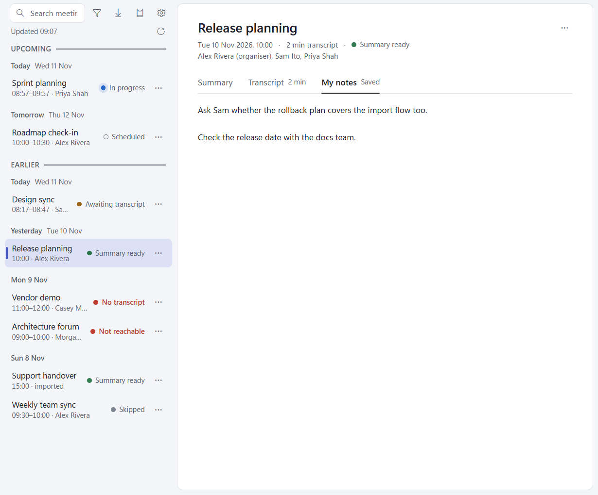

# My notes

Every meeting has a **My notes** tab, so you can write notes before, during and after the call: on an upcoming
meeting, one in progress, one awaiting its transcript, or one you skipped.

- Notes save on their own: after a short pause in typing, and at once when you switch tab or meeting, open Settings,
  switch to another window, close the window to the tray, or quit from the tray. The tab reads "Saving…", then "Saved".
- They are plain text, kept in the meeting's folder as `notes.md`. You can edit that file in another editor too; the
  tab shows the change the next time you open it.
- Nothing else ever writes `notes.md`: summaries, re-runs, captures and Replace transcript leave it untouched.
- Writing notes on a calendar meeting that has no folder yet makes its folder. That doesn't change what happens to
  the meeting: it is still fetched and summarised as usual, and the transcript lands beside your notes.
- Keys typed in the notes stay in the notes: S, E and Del act only on the meeting list.

[Search](search.md) finds text in your notes, and [the Claude skill](claude-skill.md) reads them.

## If a save fails

The tab reads **Not saved** and an error banner says why. Your text stays in the box and the app keeps retrying, on
every later save, redraw or switch, until it lands. While the library folder is missing nothing can be saved; the text
is saved once the folder is back, or into the folder you choose with **Choose folder**.

The app never overwrites a `notes.md` that holds other notes (for example, one edited elsewhere since). It refuses
that save with a notice, and the tab reads "Not saved" with your text still in the box; type in it to replace the
file's notes with yours.
