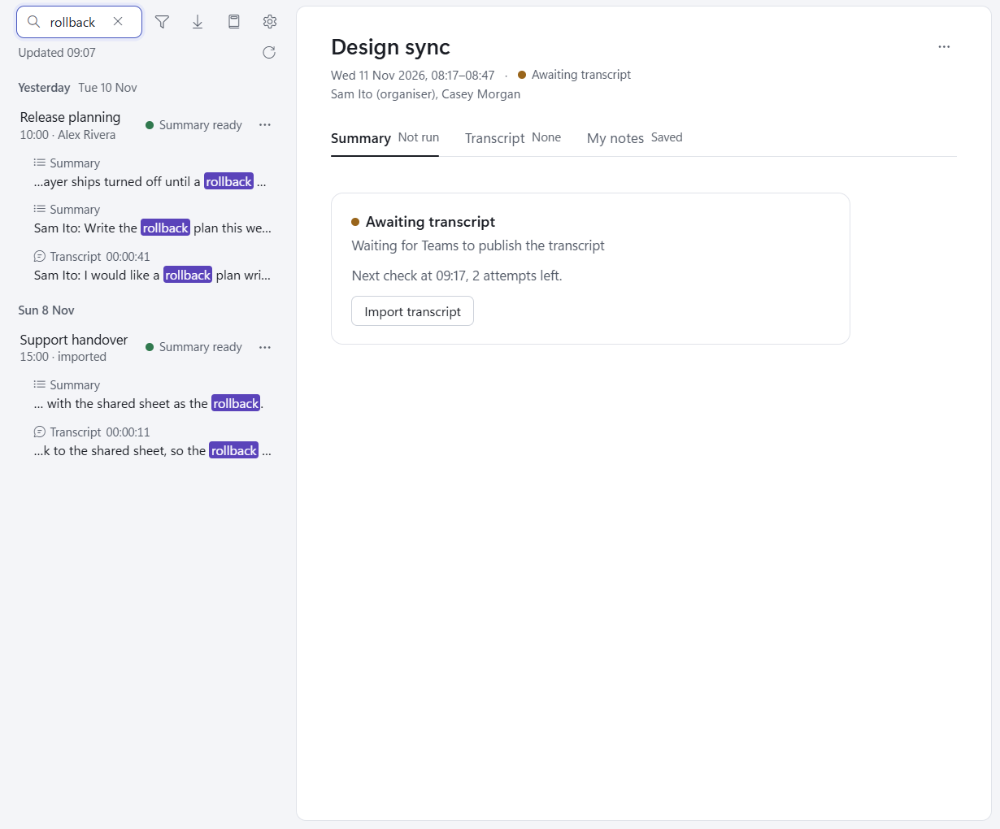

# Search

Type in **Search meetings** at the top of the list. The list filters as you type to the meetings whose title,
organiser or attendees, summary, transcript or notes contain what you typed. Case is ignored, and the whole query is
matched as one phrase.

Under each meeting:

- a title or people hit, labelled **Title**, **Organiser** or **Attendees**;
- then up to 3 lines from its files, each labelled with the tab it is on (Summary, Transcript with the turn's time,
  or My notes), with the match marked.

Click a line (or move to it with the arrow keys and press Enter) to open the meeting on that tab. A transcript line
scrolls to its turn and marks the match. Click the meeting itself, or a title or people hit, to open it.

No hits reads `No matches for "<query>"`. Press **Esc** in the box, or the **X** inside it, to clear the search.

Notes:

- Search works inside the series filter too ([Show all in this series](meeting-actions.md#show-all-in-this-series)).
- The app's own headings are never hits (the summary's title, date line and section headings, and the transcript's
  Corrections applied list).
- A meeting that was never summarised has no readable transcript yet, so only its notes and details are searched.
