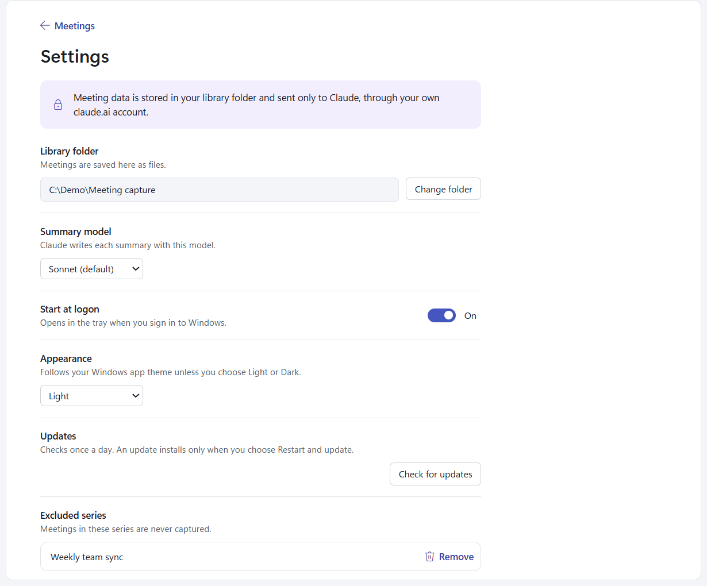

# Settings

Open Settings with the gear at the top of the list (or **Settings** in the tray menu). **Meetings** at the top, or
Esc, goes back. Every change saves at once.

- **Library folder**: where meetings are kept as files. **Change folder** switches to another folder; the app then
  lists the meetings in that folder. It doesn't move or copy the meetings from the old one, so move them yourself
  in Explorer if you want them to follow. The [Claude skill](claude-skill.md) is updated to the new path.
- **Summary model**: the Claude model that writes summaries: **Sonnet** (the default), **Opus** or **Haiku**. It
  applies to the next summary; [re-run](meeting-actions.md#run-summary-and-re-run-summary) a summary to use it on a
  meeting already done. Fetches and calendar reads always use Haiku.
- **Start at logon**: opens the app in the tray when you sign in to Windows, so meetings are captured without you
  opening it. The tray menu has the same switch.
- **Appearance**: **System** (follows your Windows app theme, the default), **Light** or **Dark**.
- **Updates**: **Check for updates** checks now. See [Updates](updates.md).
- **Excluded series**: the series you excluded with [Exclude series](meeting-actions.md#exclude-series). **Remove**
  includes a series again.

Settings are kept in `%APPDATA%\com.lawls91.meetingcapture\settings.json`, apart from your library, and survive an
uninstall or an update.
