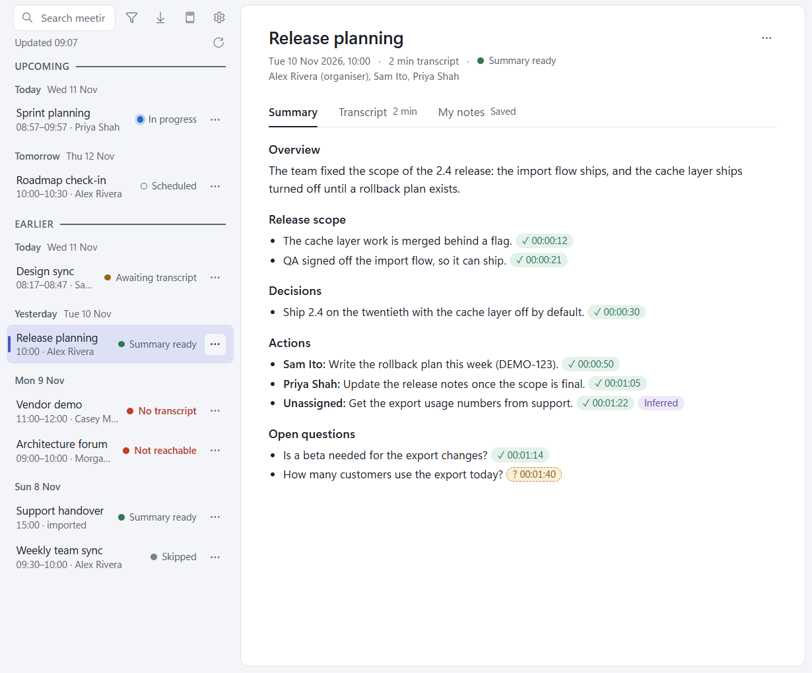
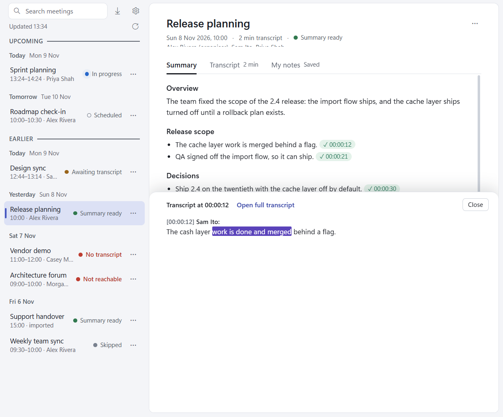
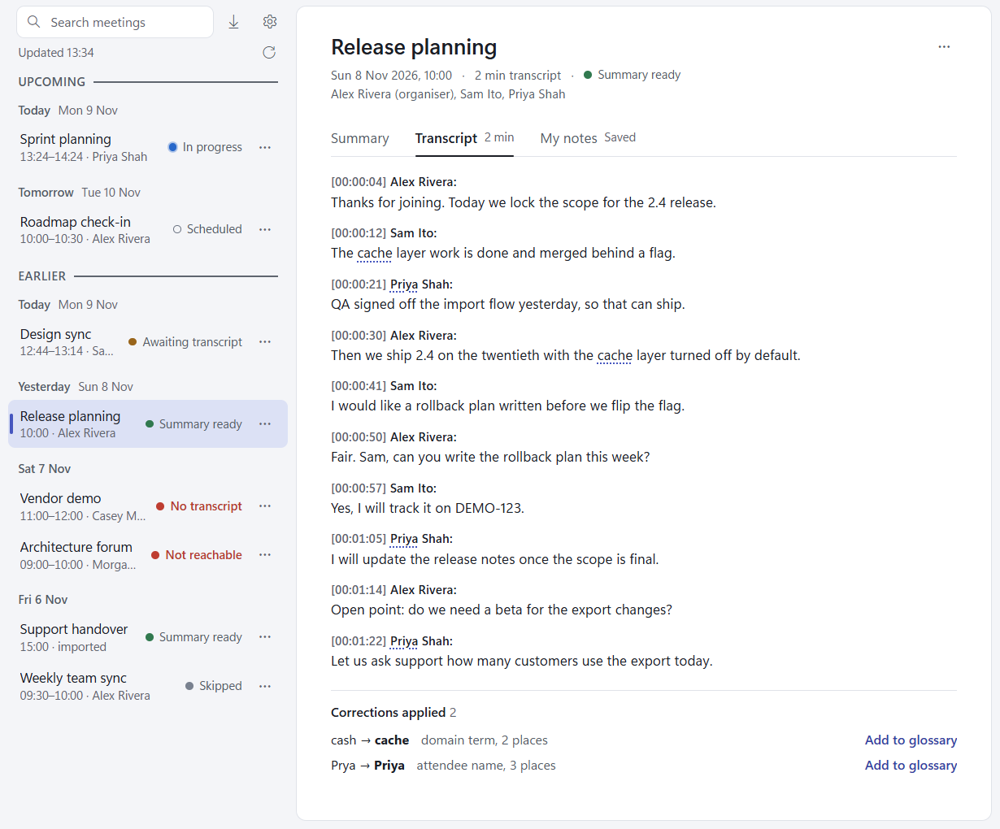

# Summaries and transcripts

Open a meeting to see three tabs: **Summary**, **Transcript** (with its length, or "None") and
[My notes](my-notes.md).

## The summary

Once a transcript is saved, Claude writes the summary with the model chosen in [Settings](settings.md) (Sonnet by
default). It has, in order:

- **Overview**: a few sentences.
- A section per topic discussed.
- **Decisions**.
- **Actions**, each with its owner ("Sam Ito:"), or "Unassigned:" when nobody took it.
- **Open questions**.

Empty sections are left out.

### Citation chips

Every point ends with one or more chips giving the transcript time it rests on. The app checks each one itself,
against the raw transcript: Claude must quote at least three words from the transcript line at that time.

- **✓ 00:00:12** (green): the quoted words are in the transcript at that time.
- **? 00:01:40** (amber, dashed): the citation didn't check out. Treat the point with care.

Other chips:

- **Inferred**: the meeting implied this, but nobody said it outright.
- **No citation**: the point cites nothing.
- **Key not found**: the point names a Jira key that Claude's Jira lookups didn't find (hover to see which). Without
  the Atlassian connector every key is "not found".

Click a chip to open the transcript beside the point:

For a verified citation the sheet shows the whole speaker turn with the quoted words marked, and **Open full
transcript** jumps to it on the Transcript tab. For an unverified one it shows the transcript line it was checked
against, the claimed quote, and why it failed: "No transcript line at 00:01:40", "Quote too short to check: under 3
words", or "Quoted words not found in this cue". **Close** (or Esc) puts focus back on the chip.

### When the summary is ready

A notification says "Summary ready: 2 decisions, 3 actions." Click it to open the meeting (see
[Known limitations](troubleshooting.md#known-limitations) for when a click can't). A failed run says "Summary
failed", and the meeting's card gives the reason with a **Re-run summary** button.

### Re-run summary

**Re-run summary** (on the meeting's **...** menu) writes the summary again, for example after you changed the
summary model or added glossary entries. It replaces the summary and the readable transcript, never the raw
transcript or your notes.

## The transcript

The Transcript tab shows one paragraph per speaker turn, with its time and speaker.

### Corrections

Transcription mishears names and terms. Each summary run also lists the corrections it would make ("cash" to
"cache", "Prya" to "Priya"), and the app applies them to the readable transcript, as whole words only:

- A corrected word has a dotted underline; hover it to see what Teams wrote ("Was: cash").
- A strip above the first turn says how many corrections the transcript has and how many are still to review ("2
  corrections in this transcript · 1 to review", or "all in glossary"). **Show** lists each correction with its
  reason and how many places it changed.

Corrections never change the raw transcript (`transcript.vtt`), and citations are always checked against the raw
words.

### The glossary

**Add to glossary** beside a correction adds it to `glossary.md` in the root of your library, as a line
`cash -> cache`. Every later summary run gets the glossary, so the same mishearing is fixed in every meeting.
The [Glossary](glossary.md) page reviews every meeting's corrections at once, and edits the glossary. Re-run a
summary to apply new entries to a meeting already summarised.

## The files

Each meeting is a folder in your library, named `YYYY-MM-DD HHmm Subject`:

| File | What it is |
| --- | --- |
| `meeting.json` | The meeting's details and state. |
| `transcript.vtt` | The transcript exactly as Teams (or your import) gave it. |
| `transcript.md` | The readable transcript, corrections applied. |
| `summary.md` | The summary as Markdown. |
| `summary.json` | The data the summary is drawn from. |
| `notes.md` | [Your notes](my-notes.md). |

**Open folder** on a meeting's **...** menu opens its folder in Explorer.
